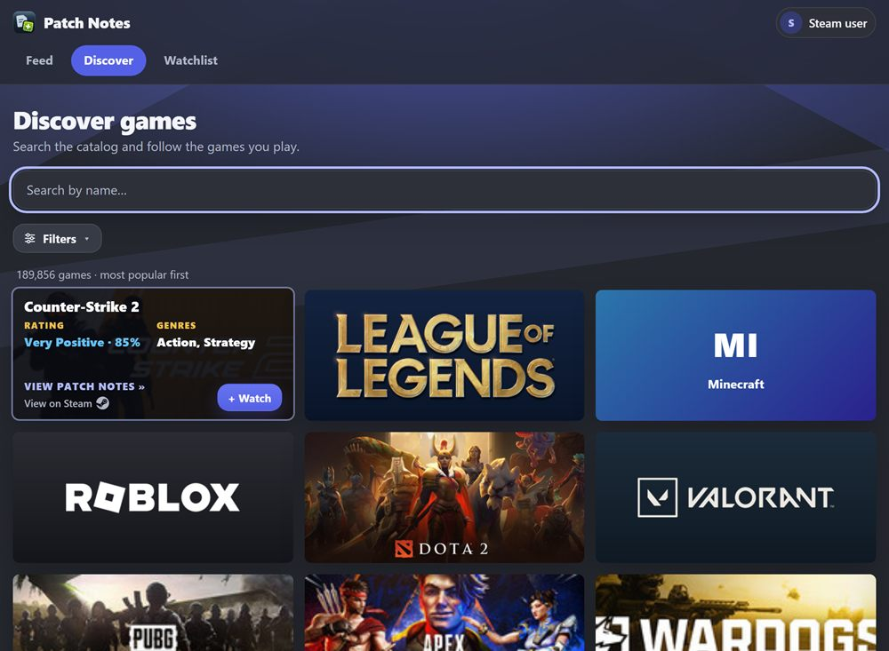
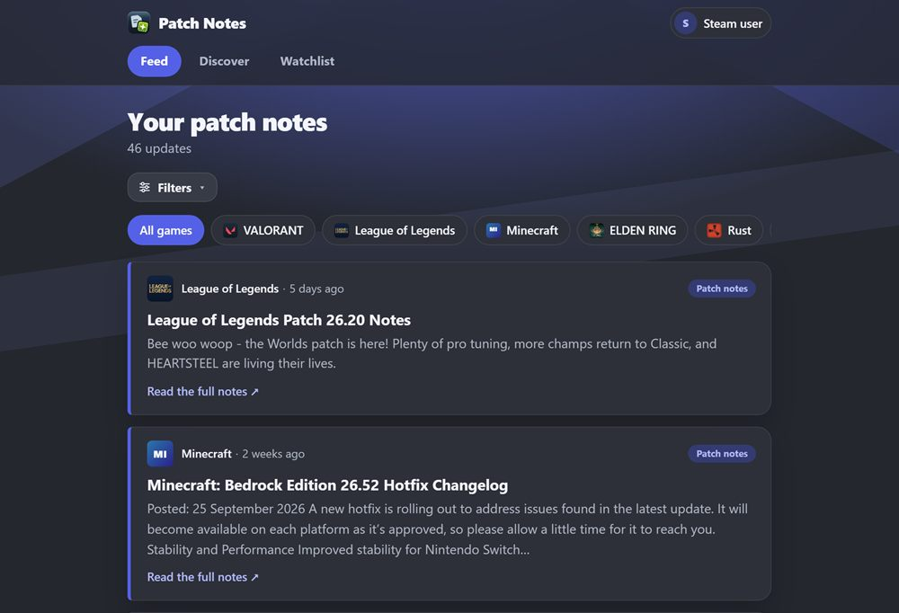

<h1 align="center">Hi, I'm Gabe 👋</h1>

  <b>Entry-level Java backend developer</b> · Dallas, TX 
  I build REST APIs with Spring Boot and MySQL, and I put them on the internet.

  <a href="https://patchnoteaggregator.com"><b>▶ Live project</b></a> &nbsp;·&nbsp;
  <a href="https://www.linkedin.com/in/gabriel-carroll/">LinkedIn</a> &nbsp;·&nbsp;
  <a href="mailto:Carrollgbusiness@gmail.com">Email</a>

  
  
  
  
  
  

---

## About me

I came to software from retail and warehouse work, through [Year Up](https://www.yearup.org/)'s Application Development program, and
I've been building in public since April 2026: from Java basics and SQL to Spring Boot APIs and a site that is live on AWS.

I use AI coding assistants to learn, debug and review. I read, test and can explain every change I ship.

**Looking for:** an entry-level Java / backend developer role where I can keep growing on a team.

---

## ⭐ Featured: Game Patch Notes Aggregator

**Follow the games you play and read their official patch notes in one feed.** Search about 190,000 Steam games, plus Roblox,
Minecraft, League of Legends and VALORANT, sign in with Steam, or just browse as a guest.

**[patchnoteaggregator.com](https://patchnoteaggregator.com)** · [Source code](https://github.com/Vandrae/patch-notes-aggregator) · [How it works](https://github.com/Vandrae/patch-notes-aggregator/tree/main/docs)

<table>
  <tr>
    <td width="50%"></td>
    <td width="50%"></td>
  </tr>
</table>

- **Backend:** Java 21, Spring Boot, Spring Security, JPA, Flyway, MySQL. Steam OpenID sign-in, JWT sessions in HttpOnly cookies, CSRF protection and rate limiting.
- **Background jobs:** fetches and normalizes patch notes from five different sources into one format, polling only the games someone follows, on an adaptive schedule.
- **Quality:** 350+ automated tests, including tests against a real MySQL database. Four required checks run in GitHub Actions on every pull request, and `main` is protected.
- **Shipping:** Docker Compose with Caddy for automatic HTTPS, running on an AWS EC2 server with nightly backups. Dependabot and secret scanning are on.

---

## 🛠️ More projects

| Project | What it is | Built with |
|---|---|---|
| [**Helix Bioworks API**](https://github.com/Vandrae/helix-bioworks-api) | REST API for a fictional bioengineering company's orders: layered controller → service → repository design, JPA relationships, and full create / read / update / delete endpoints. 80 commits. | Java · Spring Boot · MySQL · JPA |
| [**E-Commerce REST API**](https://github.com/Vandrae/e-commerce-api) | Added JWT authentication and role-based admin access to an existing storefront backend, plus CRUD for products, categories and cart; fixed search and inventory bugs in the inherited code. | Java · Spring Security · MySQL |
| [**Accounting Ledger**](https://github.com/Vandrae/accounting-ledger) | Team project: a console finance tracker with CSV storage and date-based reports, built with feature branches and pull requests. | Java · File I/O · Git |
| [**ThreatDiff**](https://github.com/Vandrae/threat-diff) | A World of Warcraft addon that shows how much threat you have on each enemy and how close you are to pulling aggro. [On CurseForge](https://www.curseforge.com/wow/addons/threatdiff). | Lua |

---

## 📈 How I got here

My public repositories tell the story:

`Apr` Java fundamentals → `May` object-oriented design, file I/O and Git → `Jun` SQL and first Spring Boot APIs →
`Jul–Sep` larger REST APIs → `Oct` a live AWS deployment

---

  
  

